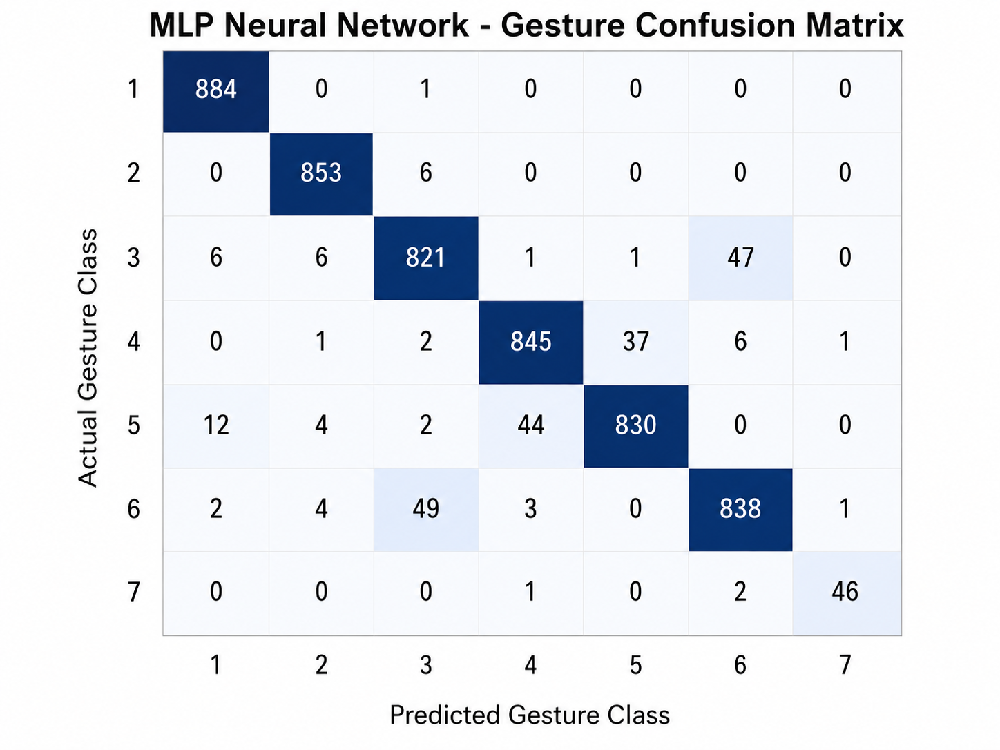

# sEMG Gesture Classification Using Machine Learning

**A machine learning approach for classifying muscle activity gestures using surface electromyography (sEMG) signals.**

## 1. Problem Statement

Surface electromyography (sEMG) signals capture the electrical activity produced by skeletal muscles. These signals can be used to study muscle activity and distinguish between different gestures. However, raw sEMG signals contain variations and require suitable preprocessing and feature extraction before they can be used effectively for machine learning.

This project addresses the problem of classifying muscle activity gestures from sEMG data by developing a software-based machine learning pipeline that extracts meaningful signal features and uses them to predict gesture classes.

## 2. Project Objectives

- Process and prepare sEMG data for machine learning.
- Extract meaningful time-domain features from segmented signal windows.
- Apply feature scaling to prepare the extracted data for classification.
- Develop an MLP-based classifier for gesture prediction.
- Evaluate model performance using training metrics and a confusion matrix.
- Save the trained model and supporting files for future use.

## 3. Methodology

The project follows these main stages:

1. **Data preparation:** Load and organize the sEMG dataset.
2. **Signal segmentation:** Divide the signals into smaller windows for analysis.
3. **Feature extraction:** Calculate five time-domain features:
   - Mean Absolute Value (MAV)
   - Root Mean Square (RMS)
   - Variance (VAR)
   - Waveform Length (WL)
   - Zero Crossings (ZC)
4. **Feature scaling:** Standardize the extracted features using a fitted scaler.
5. **Model development:** Train a Multi-Layer Perceptron (MLP) classifier to distinguish gesture classes.
6. **Performance evaluation:** Examine training metrics and classification results using visualizations.
7. **Model saving:** Store the trained classifier, feature scaler, and class labels.

## 4. Technologies Used

- Python
- Google Colab
- NumPy
- Pandas
- Scikit-learn
- Matplotlib
- Machine Learning
- Signal Feature Extraction

## 5. Results and Visualizations

### Training Accuracy and Loss

The training accuracy and loss plots help visualize how the model learns from the training data over successive iterations.

### Confusion Matrix

The confusion matrix provides a class-by-class view of the model's predictions, helping identify correctly classified samples and misclassifications.

*The figures represent model evaluation outputs from this project. Actual performance should be interpreted using the corresponding metrics and evaluation setup.*

## 6. Repository Contents

| File or Folder | Description |
|---|---|
| `semg_ml_pipeline.ipynb` | Notebook containing the machine learning workflow |
| `mlp_model.pkl` | Saved trained MLP classifier |
| `feature_scaler.pkl` | Saved feature-scaling object |
| `class_labels.npy` | Saved gesture class labels |
| `training_metrics.csv` | Training and evaluation metrics |
| `confusion_matrix_data.csv` | Confusion matrix values |
| `prediction_timeline.csv` | Prediction timeline data |
| `images/` | Model evaluation visualizations |
| `README.md` | Project documentation |

## 7. Project Outcome

This project demonstrates how signal feature extraction and supervised machine learning can be combined to classify muscle activity gestures from sEMG data. It brings together data preparation, feature engineering, model training, evaluation, visualization, and model persistence in a single software-based workflow.

## 8. Scope and Limitations

This project focuses on experimental sEMG gesture classification. Its predictions depend on the dataset, signal quality, feature extraction process, and model performance. The system is not a clinically validated diagnostic tool and is not intended to diagnose medical conditions.

## Author

**Jenolin Joy**
